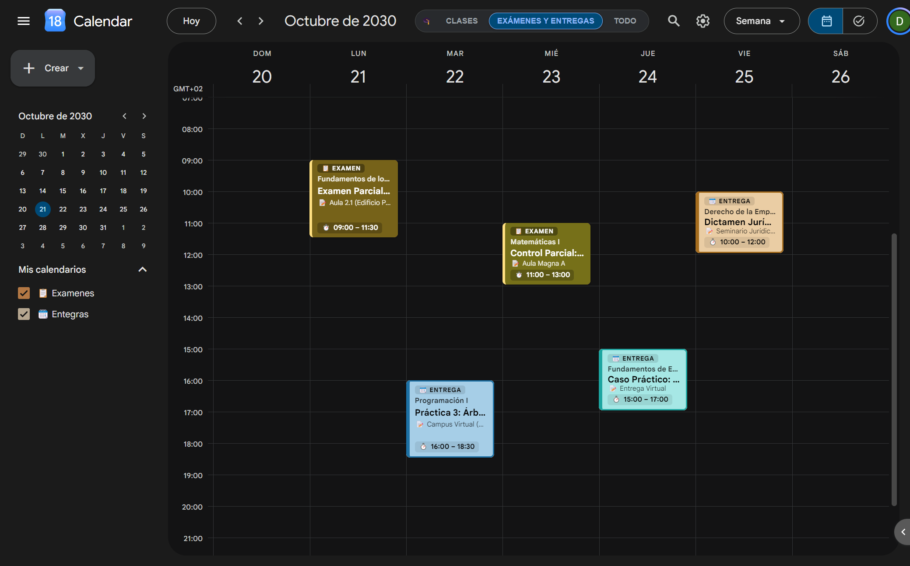
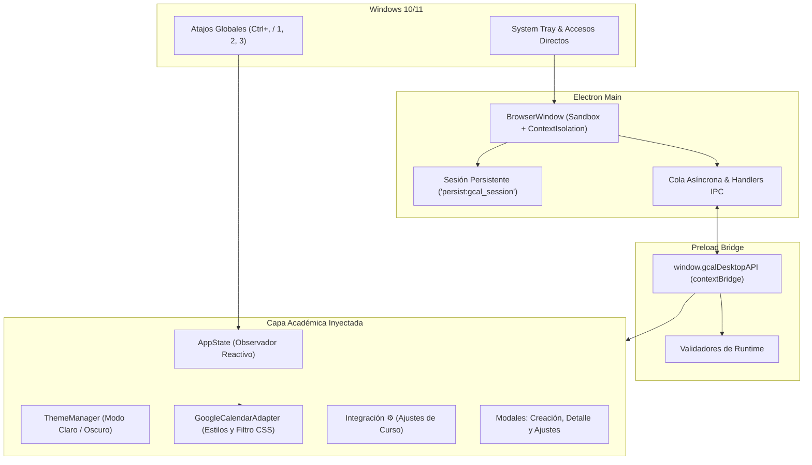

<p align="center">
  
</p>

<h1 align="center">Cursa</h1>

<p align="center">
  <strong>Tu Google Calendar universitario, sin distracciones y con superpoderes académicos.</strong>
</p>

<p align="center">
  <a href="https://github.com/dukecorse1972/cursa/releases/download/v1.0.4/Cursa-Setup-1.0.4.exe"></a>
  <a href="https://github.com/dukecorse1972/cursa/releases/download/v1.0.4/Cursa-v1.0.4-windows-x64.zip"></a>
  <a href="RELEASE_NOTES_v1.0.4.md"></a>
</p>

<p align="center">
  
  
  
  
  
</p>

---

## 💡 ¿Qué es Cursa?

**Google Calendar** es la mejor herramienta para sincronizar eventos, pero no fue diseñado para la vida universitaria:
- Mezcla tus clases con cumpleaños, recordatorios personales y festivos.
- Los colores por defecto no permiten diferenciar un examen crítico de una simple práctica.
- Saturación visual constante que dificulta concentrarse en lo importante de la semana.

**Cursa** es una aplicación de escritorio nativa para **Windows** que envuelve Google Calendar con una capa quirúrgica de productividad para estudiantes de ingeniería, universidad y bachillerato:
- **0 latencia**: Los filtros y pestañas se aplican al nivel del motor de renderizado CSS.
- **100% oficial y privado**: Tu cuenta se sincroniza directamente con los servidores de Google. Cero servidores intermediarios ni telemetría.
- **Flujo de estudio real**: Separa tus clases lectivas de tus exámenes y fechas límite con una sola pulsación.

---

## 🖥️ Interfaz Integrada

<p align="center">
  
</p>

La capa de **Cursa** no sobrecarga la interfaz de Google Calendar; se integra directamente con sus componentes oficiales en 3 puntos clave:

* **Cápsula de Contexto (`1`, `2`, `3`)**: Centrada en la cabecera, conmuta en 0ms entre tus clases lectivas, tus fechas críticas de exámenes/entregas y la vista global.
* **Ajustes Mimetizados en el Engranaje (`⚙️` o `Ctrl+,`)**: Ubicación natural en el menú desplegable oficial de Google, sin desajustar el buscador ni desplazar los iconos de usuario.
* **Chips Semanales "Badge Pro"**: Reconocimiento visual instantáneo entre **Exámenes** (bloque sólido de alto impacto con borde dorado), **Entregas** (tonos pastel HSL suaves) y tareas completadas (**✓ HECHA**).

---

## ⚡ Características Principales

### 🎯 1. Modos de Concentración con Atajos (`1`, `2`, `3`)
Cambia instantáneamente de contexto según lo que necesites en cada momento:
* **`[1]` CLASES**: Muestra exclusivamente los calendarios de tus asignaturas lectivas.
* **`[2]` ENTREGAS Y EXÁMENES**: Aísla tus fechas límite, parciales y entregas de proyectos.
* **`[3]` TODO**: Vista unificada completa de todas tus asignaturas y tareas académicas.
* *Limpio de ruido*: Oculta automáticamente calendarios de cumpleaños, botones promocionales y enlaces innecesarios.

### ⚙️ 2. Ajustes de Curso Integrados en el Engranaje (`⚙️`)
* **Ubicación Nativa**: En lugar de saturar la barra superior desalineando el buscador de Google, la opción `🎓 Ajustes de Curso` se integra directamente en el menú desplegable del engranaje oficial (`⚙️`).
* **Protección contra Clics Nativos**: Sistema de supresión de eventos en fase de captura (`useCapture: true`) que evita que Google abra su pantalla de ajustes genéricos.
* **Atajo Global**: Pulsa `Ctrl + ,` en cualquier momento para abrir el asistente de configuración.

### 📚 3. Soporte Multicurso Dinámico (1 a 10+ Asignaturas)
* **Sin límite rígido**: Añade tantas asignaturas como curses este cuatrimestre con los botones `+ Añadir` y `✕ Eliminar`.
* **Numeración Secuencial Visual**: Cada materia cuenta con su índice ordenado (`1.`, `2.`, `3.`...).
* **Rotación Continua de Color**: Las materias adoptan secuencialmente los tonos de la paleta elegida con selector de color individual por fila.

### 🎨 4. Paletas de Autor para Estudio
Selección en 1 clic entre 4 paletas estéticas curadas de papelería universitaria:

| Paleta | Inspiración | Muestra de Tonos |
|---|---|---|
| **Zebra Mildliner™ Pastel** | Destacadores japoneses de estudio (*GoodNotes / Notion*) | 🔵 `#98D5E8` 🟢 `#A1D0CA` 🟡 `#F0F4A3` 🌸 `#FFB6D9` 🟠 `#FFDFB5` |
| **Catppuccin™ Pastel** | Diseño comunitario relajante de alto contraste | 🔷 `#74c7ec` 🌿 `#a6e3a1` 🍑 `#fab387` 🟣 `#cba6f7` 🍉 `#f38ba8` |
| **Nord™ Frost & Aurora** | Estética ártica nórdica equilibrada para máxima concentración | ❄️ `#88C0D0` 🧊 `#81A1C1` 🌲 `#A3BE8C` 🌕 `#EBCB8B` 🍁 `#D08770` |
| **Morandi Editorial** | Tonos terrosos y apagados elegantes de estilo editorial | 🌫️ `#99B9C6` 🍃 `#A9B4A1` 🪨 `#DAC5C3` 🍇 `#B7A9B3` 🏺 `#DB787A` |

### 🏷️ 5. Badge Pro y Tratamiento HSL
* **Exámenes**: Destacados con fondo sólido en el tono de la materia, tipografía de alto contraste y borde dorado distintivo.
* **Entregas**: Chips en tonos suaves calculados matemáticamente mediante HSL sobre el color del calendario.
* **Control de Entregas Realizadas**: Marca tareas como `"✓ HECHA"` para atenuarlas en escala de grises y despejar la vista semanal.
* **Bilingüe**: Extracción precisa de fechas tanto en español (`"15 de octubre"`) como en inglés (`"October 15"`).

---

## ⌨️ Atajos de Teclado

| Tecla | Acción |
|:---:|---|
| <kbd>1</kbd> | Cambiar a pestaña **CLASES** |
| <kbd>2</kbd> | Cambiar a pestaña **ENTREGAS Y EXÁMENES** |
| <kbd>3</kbd> | Cambiar a pestaña **TODO** |
| <kbd>Ctrl</kbd> + <kbd>,</kbd> | Abrir **🎓 Ajustes de Curso** (Asignaturas y Paletas) |
| <kbd>Esc</kbd> | Cerrar cualquier ventana emergente abierta |
| <kbd>t</kbd> | Ir a la fecha actual ("Hoy") |
| <kbd>j</kbd> / <kbd>k</kbd> | Navegar a la semana anterior / siguiente |

---

## 🚀 Instalación y Puesta en Marcha

### Opción 1: Instalador Oficial (.exe) — Recomendado
1. Descarga [`Cursa-Setup-1.0.4.exe`](https://github.com/dukecorse1972/cursa/releases/download/v1.0.4/Cursa-Setup-1.0.4.exe).
2. Ejecuta el asistente. Se instala en `%LOCALAPPDATA%\Programs\Cursa` sin requerir permisos de administrador ni ventanas UAC.
3. Crea accesos directos en el **Escritorio** y en el **Menú de Inicio** automáticamente.

### Opción 2: Versión Portable (.zip)
1. Descarga [`Cursa-v1.0.4-windows-x64.zip`](https://github.com/dukecorse1972/cursa/releases/download/v1.0.4/Cursa-v1.0.4-windows-x64.zip).
2. Descomprime y ejecuta `Cursa.exe`. Ideal para llevar en USB sin tocar el sistema.

---

## 🔒 Privacidad y Seguridad

* **Conexión Directa con Google**: El inicio de sesión se realiza en `accounts.google.com`. Ninguna credencial ni token pasa por servidores intermedios.
* **Aislamiento Total**: Sesión confinada en una partición protegida de Chromium (`persist:gcal_session`).
* **Sandbox y Context Isolation**: Procesos web completamente aislados del sistema operativo (`contextIsolation: true`, `sandbox: true`).
* **Cero Telemetría**: Sin analíticas, sin rastreadores y sin dependencias de red de terceros.

---

<details>
<summary><strong>💻 Información para Desarrolladores y Compilación Local</strong></summary>

### Requisitos
* **Node.js**: v20+ LTS
* **npm**: v10+
* **OS**: Windows 10 u 11 (64-bit)

### Inicio Rápido
```bash
# 1. Clonar el repositorio
git clone https://github.com/dukecorse1972/cursa.git
cd cursa

# 2. Instalar dependencias
npm install

# 3. Ejecutar las 84 pruebas automatizadas
npm test

# 4. Iniciar en desarrollo
npm start
```

### Scripts del Proyecto
| Comando | Función |
|---|---|
| `npm start` | Compila TypeScript y arranca la app en Electron |
| `npm test` | Ejecuta la suite de 84 pruebas unitarias con el runner nativo de Node.js |
| `npm run pack` | Empaqueta la versión portable en `release/win-unpacked/` |
| `npm run dist` | Genera el instalador oficial NSIS (`.exe`) en `release/` |
| `npm run shortcut` | Genera o repara los accesos directos en Windows |

### Arquitectura en 4 Capas

</details>

---

## ⚖️ Aviso Legal y de Marcas

Este proyecto es un desarrollo independiente de código abierto con fines educativos y de productividad personal. **No** está afiliado, respaldado, patrocinado ni certificado por Google LLC ni Alphabet Inc. *Google*, *Google Calendar* y sus respectivos logotipos son marcas registradas de Google LLC.

---

## 📄 Licencia

Este proyecto está bajo la Licencia **MIT**. Consulta el archivo [LICENSE](LICENSE) para más detalles. Desarrollado con ❤️ por **Dario** ([@dukecorse1972](https://github.com/dukecorse1972)).
