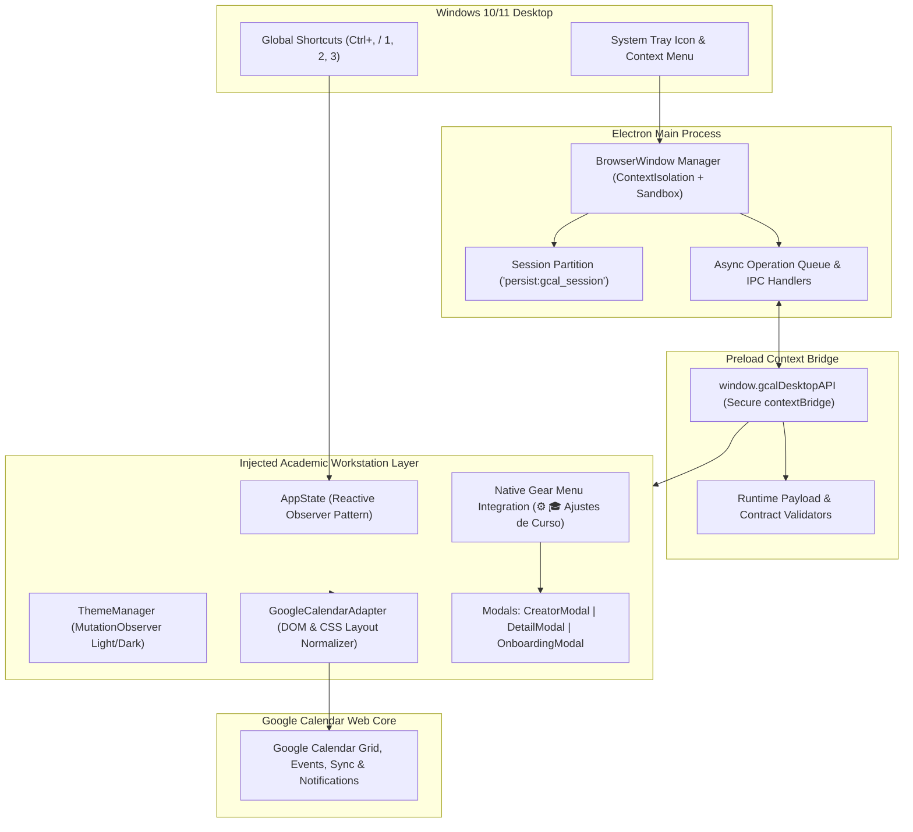

# AcademiCal Desktop — Academic Companion for Google Calendar

[-2563eb?logo=windows&logoColor=white)](https://github.com/dukecorse1972/academic-calendar-desktop/releases/download/v1.0.0/AcademiCal.Desktop-Setup-1.0.0.exe)
[-475569?logo=zip&logoColor=white)](https://github.com/dukecorse1972/academic-calendar-desktop/releases/download/v1.0.0/AcademiCal-Desktop-v1.0.0-windows-x64.zip)
[](RELEASE_NOTES_v1.0.0.md)
[](https://github.com/dukecorse1972/academic-calendar-desktop/actions)
[](https://www.electronjs.org/)
[](https://www.typescriptlang.org/)
[](https://opensource.org/licenses/MIT)
[](https://nodejs.org/)

Aplicación de escritorio de alto rendimiento para **Windows** que proporciona la experiencia completa de **Google Calendar** enriquecida con una capa especializada de gestión y productividad académica (filtrado dinámico de asignaturas, control de entregas y exámenes, cálculo inteligente de contrastes de color, tematización reactiva y escalado dinámico de materias).

---

> [!NOTE]
> ### ⚖️ Aviso Legal y de Marcas Registradas (Legal Disclaimer)
> Este proyecto es un desarrollo independiente de código abierto con fines educativos y de productividad personal. **No** está afiliado, respaldado, patrocinado ni certificado por Google LLC ni Alphabet Inc. *Google*, *Google Calendar* y sus respectivos logotipos son marcas registradas de Google LLC.

---

## 🚀 Descarga e Instalación

AcademiCal Desktop ofrece múltiples métodos de distribución adaptados tanto a estudiantes y usuarios finales como a desarrolladores:

### 🌟 Método 1: Instalador Oficial para Windows (Recomendado)

La forma más rápida, cómoda y visual de disfrutar de AcademiCal Desktop:

1. **Descarga directa con 1 clic**: Haz clic en el botón superior o descarga directamente [`AcademiCal Desktop-Setup-1.0.0.exe`](https://github.com/dukecorse1972/academic-calendar-desktop/releases/download/v1.0.0/AcademiCal.Desktop-Setup-1.0.0.exe) (también disponible en la [pestaña oficial de Releases](https://github.com/dukecorse1972/academic-calendar-desktop/releases/latest)).
2. **Ejecuta el archivo**: Haz doble clic sobre el instalador descargado.
3. **Instalación sin complicaciones**:
   * **Cero requisitos**: No requiere tener instalado Node.js, npm ni Git.
   * **Sin permisos de Administrador**: Instalación segura por usuario en `%LOCALAPPDATA%\Programs\AcademiCal Desktop`, sin ventanas molestas de elevación UAC.
   * **Experiencia visual moderna**: Asistente con interfaz personalizada, temática visual académica y banner de bienvenida.
   * **Accesos directos automáticos**: Genera accesos directos automáticos en el **Escritorio** y en el **Menú de Inicio**.
   * **Lanzamiento inmediato**: Se inicia automáticamente al finalizar la instalación.
   * **Desinstalación limpia**: Integración total con *Configuración de Windows > Aplicaciones instaladas*.

---

### 📦 Método 2: Versión Portable (.zip)

Ideal si prefieres llevar la aplicación en una memoria USB o ejecutarla sin modificar el registro del sistema:

1. Descarga el paquete [`AcademiCal-Desktop-v1.0.0-windows-x64.zip`](https://github.com/dukecorse1972/academic-calendar-desktop/releases/download/v1.0.0/AcademiCal-Desktop-v1.0.0-windows-x64.zip).
2. Descomprime la carpeta en cualquier ubicación de tu equipo.
3. Ejecuta `AcademiCal Desktop.exe` para empezar a trabajar de inmediato.

---

### 💻 Método 3: Entorno de Desarrollo (Código Fuente)

Si eres desarrollador, estudiante de ingeniería o deseas auditar y compilar el código por ti mismo:

#### Requisitos Previos
* **Node.js**: v20.x o v22.x LTS (compatible con Node 24)
* **npm**: v10+
* **Sistema Operativo**: Windows 10 u 11 (64-bit)

#### Pasos de Instalación y Ejecución

```bash
# 1. Clonar el repositorio
git clone https://github.com/dukecorse1972/academic-calendar-desktop.git
cd academic-calendar-desktop

# 2. Instalar dependencias de desarrollo
npm install

# 3. Ejecutar la suite de pruebas automatizadas (58 tests)
npm test

# 4. Iniciar la aplicación en modo desarrollo
npm start
```

#### Scripts Disponibles

| Comando | Descripción |
|---|---|
| `npm start` | Compila TypeScript y arranca la aplicación con recarga en caliente. |
| `npm test` | Ejecuta la suite completa de 58 pruebas automatizadas con el runner nativo de Node.js. |
| `npm run build` | Compila TypeScript del proceso principal y empaqueta el preload bundle con esbuild. |
| `npm run dist` | Empaqueta la aplicación y compila el instalador oficial NSIS (`.exe`) en `release/`. |
| `npm run pack` | Genera la versión desempaquetada portable en `release/win-unpacked/`. |
| `npm run shortcut` | Crea accesos directos de Windows para el entorno local de desarrollo. |

---

## 🏛️ Arquitectura del Sistema

El proyecto opera bajo un modelo de desacoplamiento estricto en 4 capas sobre Electron:



```text
┌────────────────────────────────────────────────────────────────────────┐
│                   WINDOWS DESKTOP APPLICATION                          │
│                                                                        │
│  ┌──────────────────────────────────────────────────────────────────┐  │
│  │                    ELECTRON MAIN PROCESS                         │  │
│  │  - Partición persistente aislada ('persist:gcal_session')        │  │
│  │  - Gestión de ventanas seguras (contextIsolation + sandbox)      │  │
│  │  - Restricción estricta de permisos por origen                   │  │
│  │  - Single Instance Lock (instancia única)                        │  │
│  └──────────────────────────────────┬───────────────────────────────┘  │
│                                     │ IPC Bridge                       │
│  ┌──────────────────────────────────▼───────────────────────────────┐  │
│  │                       PRELOAD CONTEXT                            │  │
│  │  - Exposición segura vía contextBridge ('window.gcalDesktopAPI') │  │
│  │  - Detección de ciclo de vida DOM (DOMContentLoaded / Load)      │  │
│  └──────────────────────────────────┬───────────────────────────────┘  │
│                                     │ DOM Injection                    │
│  ┌──────────────────────────────────▼───────────────────────────────┐  │
│  │                   ACADEMIC WORKSTATION LAYER                     │  │
│  │  - AppState (Patrón Observador reactivo / Fuente Única de Verdad)│  │
│  │  - ThemeManager (Detección de temas claro/oscuro en tiempo real) │  │
│  │  - GoogleCalendarAdapter (Normalización de layout y estilos)     │  │
│  │  - Integración nativa en menú engranaje: ⚙️ > [🎓 Ajustes Curso]  │  │
│  │  - Pestañas integradas: [CLASES] | [ENTREGAS Y EXÁMENES] | [TODO]│  │
│  │  - Modales: Creador, Visor extendido y Asistente de Curso        │  │
│  └──────────────────────────────────┬───────────────────────────────┘  │
│                                     │                                  │
│  ┌──────────────────────────────────▼───────────────────────────────┐  │
│  │                   GOOGLE CALENDAR WEB CORE                       │  │
│  │  - Sincronización oficial de cuenta, eventos, notificaciones     │  │
│  └──────────────────────────────────────────────────────────────────┘  │
└────────────────────────────────────────────────────────────────────────┘
```

---

## ✨ Características Principales

### 1. ⚙️ Acceso a Ajustes Integrado en el Menú de Google (Sin Desajustes)
* **Integración Limpia**: En lugar de saturar la barra superior empujando el buscador o el perfil, la opción `🎓 Ajustes de Curso` se inyecta directamente dentro del menú desplegable del engranaje oficial (`⚙️`).
* **Supresión Estricta de Eventos de Google**: Intercepta eventos de ratón (`pointerdown`, `mousedown`, `click`) en fase de captura (`useCapture: true`) y limpia atributos `jsaction` de Google para evitar navegaciones no deseadas a `/settings`.
* **Atajo Universal de Escritorio**: Pulsa `Ctrl+,` en cualquier momento para desplegar los ajustes de asignaturas y paletas.

### 2. 📚 Escalado Dinámico de Asignaturas (Soporte Multicurso 1..10+)
* **Sin Límite Fijo**: Permite gestionar cualquier número de asignaturas simultáneas (4, 6, 8, 10 o más materias por cuatrimestre).
* **Numeración Secuencial Visual**: Cada fila muestra su número de orden (`1.`, `2.`, `3.`...).
* **Rotación Continua de Color**: Añadir una asignatura asigna automáticamente el siguiente color de la paleta seleccionada, con soporte de selector individual por fila y algoritmo de dispersión hash para más de 10 materias.

### 3. 🎨 Paletas de Color Especializadas y Curadas
Selección en 1 clic entre 4 paletas estéticas oficiales extraídas de la teoría del color y papelería de estudio:
* **Zebra Mildliner™ Pastel**: Tonos japoneses suaves para estudio universitario (*GoodNotes*, *Notion*).
* **Catppuccin™ Pastel**: Paleta moderna de alto contraste para interfaces limpias y relajantes.
* **Nord™ Frost & Aurora**: Diseño ártico nórdico equilibrado para máxima concentración.
* **Morandi Editorial**: Tonos terrosos y apagados elegantes de estilo editorial.

### 4. ⚡ Gestión Académica por Contexto
* **Pestaña CLASES (`1`)**: Muestra exclusivamente los calendarios de tus asignaturas lectivas.
* **Pestaña ENTREGAS Y EXÁMENES (`2`)**: Aísla tus hitos críticos (exámenes y fechas de entrega de proyectos) y te permite crear nuevos eventos con un solo clic.
* **Pestaña TODO (`3`)**: Vista global unificada de todas tus categorías académicas y tareas.
* **Eliminación de Distracciones**: Oculta permanentemente elementos que saturan la interfaz como cumpleaños, accesos promocionales y botones no relevantes para el estudio.

### 5. 🏷️ Diseño Visual "Badge Pro" y Adaptación HSL
* **Exámenes**: Chips destacados con fondo sólido e intenso en el color de la asignatura, tipografía de alto contraste y borde dorado distintivo.
* **Entregas**: Chips en tonos pastel suaves derivados matemáticamente mediante HSL sobre el color oficial del calendario, con bordes reforzados.
* **Gestión de Entregas Realizadas**: Permite atenuar entregas completadas ("✓ HECHA") con reducción de opacidad y escala de grises para despejar la vista semanal.
* **Soporte Bilingüe**: Extracción precisa de fechas tanto en español (`"15 de octubre"`) como en inglés (`"October 15"`).

### 6. 🌓 Tematización Dinámica Reactiva
* Sincronización inmediata con el modo Oscuro/Claro tanto de Google Calendar como de Windows mediante `MutationObserver` y `matchMedia`, sin requerir reinicio de la aplicación.

---

## ⌨️ Atajos de Teclado (Cheat Sheet)

| Atajo | Ámbito | Acción |
|:---:|:---:|---|
| **`1`** | Global (sin foco en inputs) | Cambiar a vista **CLASES** |
| **`2`** | Global (sin foco en inputs) | Cambiar a vista **ENTREGAS Y EXÁMENES** |
| **`3`** | Global (sin foco en inputs) | Cambiar a vista **TODO** |
| **`Ctrl + ,`** | Global | Abrir **🎓 Ajustes de Curso** (Asignaturas y Paletas) |
| **`Esc`** | Modal abierto | Cerrar ventana emergente activa |
| **`t`** | Cuadrícula de calendario | Volver a la fecha actual ("Hoy") |
| **`j` / `k`** | Cuadrícula de calendario | Semana o mes anterior / siguiente |

---

## 🔒 Modelo de Seguridad y Privacidad

* **Aislamiento de Contexto (`contextIsolation: true`)**: El código web nunca tiene acceso directo a Node.js ni a los recursos del sistema operativo.
* **Sandbox (`sandbox: true`)**: Los procesos de renderizado se ejecutan confinados dentro del sandbox nativo de Chromium.
* **Control de Permisos de Mínimo Privilegio**: El manejador de sesiones deniega por defecto todo acceso a dispositivos (cámara, micrófono, geolocalización) y concede exclusivamente notificaciones para el dominio oficial de Google Calendar.
* **Sesión Aislada en Disco**: La partición `persist:gcal_session` conserva el inicio de sesión del usuario en `%APPDATA%\google-calendar-win` sin contaminar perfiles del navegador principal ni exponer tokens al exterior.
* **Cero Telemetría**: La aplicación no envía analíticas ni registros a ningún servidor de terceros.

---

## 📂 Estructura del Código

```text
├── src/
│   ├── main/                 # Proceso principal de Electron (Ventanas, sesiones, IPC)
│   ├── preload/              # Script de puente aislado con contextBridge
│   ├── injected/             # Capa académica inyectada en el DOM de Google Calendar
│   │   ├── adapter/          # Adaptador de estilos, menús nativos y normalización
│   │   ├── theme/            # Motor de tokens y detección de temas Light/Dark
│   │   ├── ui/               # Pestañas, modal de creación, visor de detalle y ajustes
│   │   └── utils/            # Utilidades de DOM seguras frente a CSP
│   ├── shared/               # Constantes, tipos TypeScript, formateadores y paletas
│   └── tests/                # 58 pruebas automatizadas con Node.js Test Runner
├── assets/                   # Iconos e identidad visual (ico, png y banners del instalador)
├── walkthrough-1to1.html     # Simulador visual 1:1 de Google Calendar y la capa académica
├── walkthrough.html          # Guía interactiva paso a paso del flujo de onboarding
├── RELEASE_NOTES_v1.0.0.md   # Notas oficiales de la versión v1.0.0
├── package.json
└── tsconfig.json
```

---

## 🧪 Pruebas Automatizadas

El proyecto utiliza el **Node.js Test Runner nativo** (`node:test` y `node:assert/strict`), garantizando una ejecución ultrarrápida sin dependencias externas:

```bash
npm test
```

```text
ℹ tests 58
ℹ suites 13
ℹ pass 58
ℹ fail 0
ℹ cancelled 0
ℹ skipped 0
ℹ todo 0
ℹ duration_ms 2630.2938
```

---

## 📦 Empaquetado y Distribución Profesional

AcademiCal Desktop utiliza **electron-builder** con el motor **NSIS (Nullsoft Scriptable Install System)** configurado para una experiencia de usuario moderna, atractiva y sin fricción:

* **Instalación por usuario (`perMachine: false`)**: Se instala en `%LOCALAPPDATA%\Programs\AcademiCal Desktop`, permitiendo la instalación inmediata en cualquier equipo sin requerir contraseña de administrador ni ventanas de advertencia UAC.
* **Asistente Visual Personalizado**: Presenta una interfaz de bienvenida con temática académica, banner lateral ilustrado con el logotipo de la aplicación y accesos directos configurados.
* **Integración Completa con Windows**: Registra la aplicación en el Menú de Inicio y crea el acceso directo en el Escritorio.
* **Desinstalación Nativa y Limpia**: Integra la desinstalación en *Configuración de Windows > Aplicaciones instaladas*.

Para generar un nuevo instalador compilado:

```bash
npm run dist
```

Los artefactos resultantes se almacenan en `release/`:
* `AcademiCal Desktop-Setup-1.0.0.exe`: Instalador interactivo oficial (~80 MB).
* `AcademiCal-Desktop-v1.0.0-windows-x64.zip`: Distribución portable lista para usar (~115 MB).

---

## 📄 Licencia

Este proyecto está bajo la Licencia **MIT**. Consulta el archivo [LICENSE](LICENSE) para más detalles.
